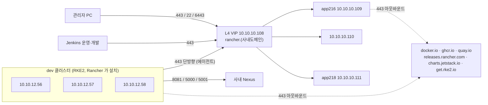

# Rancher 관리 클러스터 실서버 구축 준비 — 점검, 인프라 요청, 방화벽 요청서, dev 노드 준비
- 날짜: 2026-10-02 ~ 2026-10-12 / 브랜치: master / 관련: [kubernetes/concepts/17-onprem-rancher-rke2-preparation.md](../../kubernetes/concepts/17-onprem-rancher-rke2-preparation.md), [16 Rancher 중앙 관리](../../kubernetes/concepts/16-rancher-multi-cluster-management.md), [15 RKE2 3대 구축](../../kubernetes/concepts/15-rke2-three-node-build.md)

## 결론
Rocky 9.8 실서버 3대(관리 클러스터)와 3대(dev 클러스터)를 받아 OS 점검을 끝내고, 인프라팀 요청 항목과 방화벽 허용 요청서(xlsx)를 작성했다. 관리 서버 3대의 `/app` 바인드 마운트까지 완료. RKE2 설치는 아웃바운드 허용과 L4·DNS 처리를 기다리는 중.

## 서버 점검 결과 (관리 서버 3대)

| 항목 | 결과 | 조치 |
|---|---|---|
| swap | 0 | 완료 (처음엔 켜져 있었음) |
| firewalld | inactive | 완료 |
| SELinux | Disabled | 그대로 |
| 시간 동기화 | synced | 그대로 |
| ip_forward | 1 | 그대로 |
| /app | 500GB (`vg_app-lv_app`, xfs) | 바인드 마운트 대상 |
| NIC | ens6 | |
| docker0 | 존재 → Docker 설치됨 | 컨테이너 없으면 `disable --now` 예정 |
| NetworkManager `rke2-canal.conf` | 없음 | 인프라팀 요청 |
| 아웃바운드 | `get.rke2.io` SSL reset (차단) | 방화벽 요청 |
| DNS | 공용 리졸버 동작, Rancher hostname 미등록 | L4 VIP 등록 요청 |
| hostname | 인프라팀 설정 완료 (app216, app218 등) | |

## 변경 (서버)

| 서버 | 변경 | 이유 |
|---|---|---|
| 관리 3대 | `/etc/fstab`에 bind 3줄 (`/app/rke2/{rancher,kubelet,log-pods}` → `/var/lib/rancher`, `/var/lib/kubelet`, `/var/log/pods`), `mount -a` | 인프라팀 요청 "RKE2는 /app 아래". `data-dir` 대신 정석 경로 유지 |
| 관리 1대 | `/var/lib/rancher/rke2/server/manifests/rke2-traefik-config.yaml` (DaemonSet + hostPort 80/443, Service ClusterIP) | L4가 노드 443으로 직접 보냄. kube-vip 불필요 |

`findmnt A B C`가 빈 출력을 낸 것은 미마운트가 아니라 findmnt가 두 인자를 "장치 + 마운트 지점"으로 해석하기 때문. `findmnt | grep rke2`로 확인하니 3대 모두 정상.

## 산출물

- `~/Downloads/방화벽_허용_요청_Rancher_dev.xlsx` — 컬럼 Src.IP / Src.IP 설명 / Dst.IP / Dst.IP 설명 / Application / Port / Action / 내용. 25행(관리자→Rancher·dev, dev→Rancher 443, 아웃바운드 레지스트리, dev→Nexus 8081·5000·5001, Jenkins 운영·개발→Rancher 443). 개인 정보가 있어 저장소에는 넣지 않음.
- 인프라팀 요청 블록: NetworkManager conf, journald persistent, L4(443→3대, 헬스체크·6443/9345 여부), DNS, dev MetalLB VIP 1개(10.10.12.x), sudo 범위.

## 결정과 근거

- **바인드 마운트 > data-dir**: 문서·Rancher 기본 경로가 그대로라 운영 혼선이 없고, Rancher가 설치하는 dev 노드에도 같은 방식이 먹는다.
- **kube-vip 안 씀**: L4가 443을 분산하므로 API VIP가 없어도 된다. kubeconfig·조인 주소는 server-1 IP. L4가 6443·9345도 넘기면 VIP로 바꾼다.
- **Traefik Service ClusterIP**: LB 컨트롤러가 없어 LoadBalancer는 pending. hostPort 경로에 Service가 끼지 않는다.
- **방화벽은 노드 → Rancher 443 단방향**: 에이전트가 먼저 접속. Rancher → 노드 방향 불필요.
- **Jenkins는 Rancher 443 경유로 배포**: stage·prod가 늘어도 재요청 없음. dev 6443 직접 행은 삭제 권고.
- **GitLab 행 없음**: 클러스터는 Nexus에서 pull만 함. GitOps 도입 시 추가.
- **dev 노드 swap 유지**: `fail-swap-on=false` + kubelet 드롭인 `LimitedSwap` + `vm.swappiness=10`. 관리 서버는 swap 끔.
- **10.42/10.43 CIDR**: 사내 미사용으로 판단, 기본값 유지. 인프라팀 최종 확인 전.
- **Nexus Docker 포트 5000·5001**: 이전 세션 기록이 없어 사용자가 Nexus에서 직접 확인 후 기입.

## 남은 일
1. 인프라팀 답: NetworkManager conf 적용, 아웃바운드 허용, L4 헬스체크·6443/9345, DNS 등록, dev VIP, sudo
2. 관리 3대: `config.yaml` 작성(token 공유, tls-san에 3 IP + VIP + hostname) → server-1 설치·기동 → Ready → 2·3 조인
3. kubeconfig 복사 후 cert-manager, Rancher 2.15.2 (`replicas=3`, hostname) Helm 설치
4. dev 3대: 점검, Docker 중지, 바인드 마운트, swap 드롭인, `iscsi-initiator-utils nfs-utils`, DNS 확인 → Rancher UI Custom 클러스터 생성(Additional Kubelet Args `fail-swap-on=false`, Additional Manifest에 Traefik 설정, Registries에 Nexus) → 등록 명령 실행
5. 방화벽 요청서 확정형으로 다듬어 제출 (7번 dev VIP 행 채우기, Action 표기 통일)
