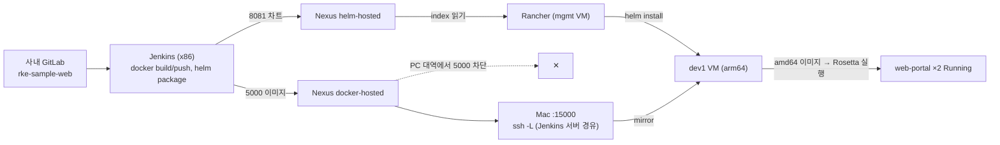

# Lima dev 클러스터에 사내 Jenkins·Nexus 이미지를 Rancher Apps로 배포 — web-portal 1.0.9
- 날짜: 2026-10-14 / 브랜치: master @ 9288f18 / 관련: [web-was-release 예제](../../kubernetes/examples/web-was-release/README.md), [Lima 실습 매뉴얼](../../kubernetes/commands/lima-rancher-rke2-lab.md), [2026-10-12 Rancher 준비 기록](2026-10-12-rancher-rke2-onprem-prep.md)

## 결론
사내 Jenkins가 빌드·push한 `web-portal` 이미지와 Helm 차트를 Lima dev1 클러스터가 Rancher Apps를 통해 설치하는 데 성공했다. "Jenkins는 빌드·push까지, 릴리즈 실행은 Rancher"라는 분업이 로컬에서 끝까지 동작한다. 로컬 한정 우회 두 가지(SSH 터널, Rosetta)가 들어갔다.



## 작업 순서와 명령

### 1. web 샘플을 사내 GitLab 저장소로
`kubernetes/examples/web-was-release/web/`에 사용자가 `git init` + remote를 둠(nested git). 원격의 초기 커밋(빈 README) 위에 올리고, Jenkins 워크스페이스가 저장소 루트가 되므로 Jenkinsfile의 `dir('web')` 블록 제거.

```bash
git -C web reset origin/master          # unborn 브랜치를 원격 초기 커밋 위로
git -C web add -A && git -C web commit -m "Add web-portal image, Helm chart, and Jenkins pipeline"
git -C web push -u origin master:init/web-portal   # master 가 protected 라 브랜치로 → MR 머지
```

### 2. Jenkins Job 통과시키기 (순서대로 막힌 것)
| 로그 | 원인 | 조치 |
|---|---|---|
| `git fetch ... HTTP code = 404` | Job 에 Git credential 없음 (GitLab 은 비공개 저장소를 404 로 숨김) | Credential `gitlab-deployer` 지정 |
| `Could not find credentials entry with ID 'nexus'` | Nexus 용 credential 미생성 | Username/password credential 생성, Jenkinsfile 의 `credentialsId` 를 그 ID 로 |
| `docker login ows-nexus:5000` → `HTTP response to HTTPS client` | 호스트명이 daemon.json `insecure-registries` 와 불일치 | Jenkinsfile 의 `NEXUS_DOCKER` 를 기존에 허용된 IP:5000 으로 |
| `helm: command not found` | Jenkins 서버에 helm 없음 | helm 3 설치 |

이후 `1.0.N` 이미지·차트 push 성공. 버전은 `1.0.${BUILD_NUMBER}` 라 실패 빌드도 번호를 소비한다.

### 3. Rancher ↔ Nexus 연결
통신 확인 결과 PC 대역(Mac·Lima VM)에서 Nexus 8081 은 열려 있고 5000·5001 은 차단.

```bash
limactl shell mgmt -- curl -s -m 5 -o /dev/null -w '%{http_code}\n' http://<NEXUS_IP>:8081/repository/helm-hosted/index.yaml   # 401 (통신 OK, 인증 필요)
limactl shell dev1 -- curl -s -m 5 -o /dev/null -w '%{http_code}\n' http://<NEXUS_IP>:5000/v2/                              # 000 timeout
```

**이미지(5000): SSH 터널 + mirror.** Nexus 5000 이 통하는 Jenkins 서버를 경유. Mac 5000 은 AirPlay 가 점유해 15000 사용.

```bash
ssh -N -L 0.0.0.0:15000:<NEXUS_IP>:5000 <user>@<JENKINS_IP>      # 별도 탭에서 유지
limactl shell dev1 -- curl -s -o /dev/null -w '%{http_code}\n' http://192.168.64.1:15000/v2/   # 401
```

Rancher → Cluster Management → dev → Edit Config → Registries: Mirrors `<NEXUS_IP>:5000` → `http://192.168.64.1:15000`, Registry Authentication(`192.168.64.1:15000`) → *Create an HTTP Basic Auth Secret*. 노드 `/etc/rancher/rke2/registries.yaml` 에 mirrors/configs 반영 확인(비밀번호 평문 포함). 차트 이미지 이름은 `<NEXUS_IP>:5000/...` 그대로 두고 노드가 터널로 우회한다.

```bash
# RKE2 containerd 소켓을 지정해야 crictl 이 동작
sudo /var/lib/rancher/rke2/bin/crictl --runtime-endpoint unix:///run/k3s/containerd/containerd.sock pull <NEXUS_IP>:5000/web-portal:1.0.7
```

**차트(8081): Apps 저장소.** dev → Apps → Repositories → Add Repository: Target *Helm Repository*, Index URL `http://<NEXUS_IP>:8081/repository/helm-hosted/`, Authentication *Create a HTTP Basic Auth Secret*. Active 후 Charts 에 `web-portal` 표시.

### 4. 설치 1차 실패: `exec format error`
`helm install --wait` 가 10분 대기 후 실패. Pod 로그 `exec /docker-entrypoint.sh: exec format error`. 이미지 `architecture: amd64`(x86 Jenkins), 노드 `aarch64`.

- Jenkins 서버에서 `docker run --privileged --rm tonistiigi/binfmt --install arm64` → `invalid argument`. 커널이 오래돼(CentOS 7 추정, binfmt `F` 플래그는 4.8+) QEMU 멀티아키 불가.
- 대신 **dev1 에 Rosetta**: `~/.lima/dev1/lima.yaml` 에 `rosetta: {enabled: true, binfmt: true}` 추가 후 `limactl stop dev1 && limactl start dev1`. `/proc/sys/fs/binfmt_misc/rosetta` 에 `enabled`, `flags: OCF` 확인.

### 5. 설치 2차 실패: `host not found in upstream "was-order"`
Rosetta 적용 후 nginx 가 기동은 하지만 정적 `proxy_pass http://was-order:8080` 때문에 기동 시 DNS 를 요구, WAS Service 가 없어 종료. web 이 WAS 유무에 종속되면 안 되므로 수정:

- `web/default.conf.template`: `resolver ${DNS_SERVER} valid=10s; set $was_upstream http://${WAS_HOST}:8080; proxy_pass $was_upstream;` (변수 proxy_pass → 요청 시점 해석, FQDN 필요)
- `web/05-dns.envsh`(+x): `/etc/resolv.conf` 첫 nameserver 를 `DNS_SERVER` 로 export. nginx 이미지 entrypoint 가 `*.envsh` 를 source.
- `web/Dockerfile`: `ENV WAS_HOST=was-order.webwas.svc.cluster.local`, `COPY --chmod=755 05-dns.envsh`
- 차트 Deployment env `WAS_HOST` = `was-order.<release ns>.svc.cluster.local`(values `wasHost` 로 덮어쓰기), `k8s/web-was.yaml` 에도 env 추가

검증은 dev1 에서 공식 `nginx:1.28-alpine` + ConfigMap 으로 테스트 Pod: `/healthz` 200, `/api/hello` 502(`could not be resolved`), 기동 정상. rancher-webhook 가 VM 재시작 직후라 네임스페이스 생성이 막혀 기존 `webwas` 에서 테스트.

GitLab master 에 push(보호 해제되어 있었음) → Jenkins 1.0.9 → Rancher 에서 failed 앱 Delete → Repositories Refresh → Install(values `image.registry` 를 Nexus 로).

### 6. 결과
```text
web-portal-5b68696bd9-fcv82  Running  0 restarts  <NEXUS_IP>:5000/web-portal:1.0.9
web-portal-5b68696bd9-rt2ks  Running  0 restarts
sh.helm.release.v1.web-portal.v1  deployed
http://app.dev.192-168-64-3.sslip.io/  → web-portal v1.0.9,  /api/hello → 502 (WAS 미설치, 정상)
```

## 변경 파일 (이 저장소)
| 파일 | 변경 |
|---|---|
| `kubernetes/examples/web-was-release/web/{default.conf.template,05-dns.envsh,Dockerfile}` | 요청 시점 DNS 해석. `nginx.conf` 삭제 |
| `.../web/chart/{templates/deployment.yaml,values.yaml}`, `.../k8s/web-was.yaml` | `WAS_HOST` 주입 |
| `.../web/Jenkinsfile`, `.../was/Jenkinsfile` | `dir()` 제거(저장소 루트 기준). 저장소 사본은 자리표시자 유지, GitLab 사본은 사내 주소 |
| `.../README.md` | 트러블슈팅 3행 추가(502, host not found, exec format error) |
| `kubernetes/commands/lima-rancher-rke2-lab.md` | 11장 "사내 Jenkins·Nexus 이미지로 배포" 추가, 10장 표에 4행 추가 |

## 결정과 근거
- **mirror 로 우회, 이미지 이름은 유지**: 차트·매니페스트의 `<NEXUS_IP>:5000/...` 를 바꾸지 않아 Jenkins 산출물을 그대로 쓴다. 방화벽이 열리면 endpoint 만 실제 주소로 바꾸고 터널을 끈다.
- **Rosetta > QEMU 멀티아키**: Jenkins 서버 커널 제약. 멀티아키는 `RUN` 없는 Dockerfile(web 의 sed 를 호스트로 이동)이면 에뮬레이션 없이 가능하므로 추후 선택지.
- **web 은 WAS 없이도 기동해야 한다**: 운영에서 WAS 장애가 web 재시작 실패로 번지지 않게. 변수 proxy_pass + resolver 가 표준 패턴.
- **버전 규칙**: `1.0.<빌드번호>` 유지. 앞자리를 사람이 관리하려면 `VERSION` 파일 + 빌드 번호(B안) 로 전환 예정.

## 남은 일
1. Rancher Apps 에서 Upgrade(1.0.10) → Rollback 리허설
2. was 저장소·Job 생성 (`tools { jdk }` 이름, Nexus 주소, credential ID 수정) → `/api/hello` 응답 확인
3. GitLab `chart/values.yaml` 의 `image.registry` 기본값을 Nexus 로 변경
4. 방화벽 요청서에 PC → Nexus 5000·5001 추가(터널 제거용), Rancher 3대 → Nexus 8081 유지
5. 실서버: 인프라팀 답 대기 → RKE2 설치
